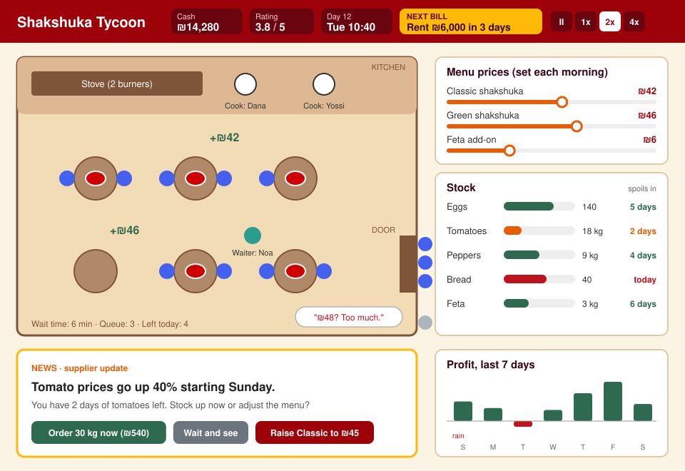

# Shakshuka Tycoon

**You don't cook the shakshuka. You keep the lights on.**

## The Concept

Shakshuka Tycoon is a business management game. You open a tiny shakshuka restaurant with very little money and try to grow it into a chain of three branches without going broke. You never cook. Your job is the money side: you set prices, order ingredients before they spoil, hire staff, and make sure there's cash in the bank when rent, salaries and taxes come due. Along the way you learn how income, expenses, profit, cash flow and taxes actually work, because your restaurant lives or dies by them.

**Platform:** PC and web browser (built in Unity, exported to WebGL). Everything is buttons, sliders and panels, so an Android version with touch controls is a natural next step.

*Concept sketch of day 12. Service is running at 2x speed, a supplier warning has just popped up, and rent is due in 3 days.*

---

## Formal Elements

### 1. Players

* **Who it's for:** ages 12 and up, from middle school students to adults. You don't need to know anything about business, because the first week in the game teaches it. It's aimed at people who enjoy tycoon, management and "number goes up" games, and it also works for teachers who want a hands-on way to teach basic economics.
* **How many players:** one.
* **Interaction pattern:** player vs. the market. There's one computer-controlled competitor, *Shakshuka Express*, that fights you for the same customers, but there's no direct multiplayer. A possible extra later is a weekly challenge where every player gets the same events and compares profit on a leaderboard.

### 2. Objectives

* **Main goal:** have three branches open by the end of month 12 and finish a full month with a positive cash flow.
* **Monthly goals:** each month gives you a short, concrete target that teaches one idea. For example: "Make ₪5,000 profit this month", "Get through the tomato shortage without taking a dish off the menu", "Pay your first tax bill on time".
* **What you must avoid:** running out of cash when a bill is due.
* **How the game tells you:** at the start of each month, Dudi, your accountant cousin, hands you a goal card. Progress bars for the main goal and the monthly goal sit in the corner of the screen. The "Next bill" box in the top bar always shows what's due next and how many days are left.

### 3. Procedures

#### The first 30 seconds

There's no long tutorial. The game opens on your tiny restaurant at 7:00 in the morning, and a few customers are already waiting outside.

* **0–10 s:** one slider lights up: *Today's price for a classic shakshuka*, set to ₪42. You can drag it or leave it, then press **Open**.
* **10–25 s:** the day plays in fast-forward. Customers walk in, sit down, and pay, and a little "+₪42" pops up for each plate. A few people look at the menu and walk away with a speech bubble: "₪42? Too much."
* **25–30 s:** the day ends with a big, simple receipt: Income ₪2,940 − Ingredients ₪980 = **Profit ₪1,960**. Right below it, Dudi says: "Nice. But rent is ₪6,000 and it's due in 14 days."

In half a minute you've made your first decision, seen it pay off, and been handed your first worry. That's the whole game in miniature.

#### Core loop: one game day (about 90 seconds at normal speed)

1. **Morning planning (the game is paused).**
   * Check the stock panel, which shows each ingredient with how many days it has left before it spoils.
   * Order from suppliers. Prices change every day, and the news ticker warns you about big changes a few days ahead.
   * Set the menu prices with sliders.
   * Assign staff to shifts.
   * Press **Open** when you're ready.
2. **Service (real time).** Customers arrive based on your price, your star rating, the weather, the day of the week and what the competitor is doing. You can switch between pause, 1x, 2x and 4x speed (Space, then keys 1, 2, 3). Events pop up as cards, and you answer them with a click. For example: a tour bus stops outside, so do you call in an extra waiter for ₪300?
3. **Evening report.** You get a breakdown of income, expenses, profit, spoiled stock, how many customers left without eating, and a "Why?" line that explains the biggest change since yesterday.
4. **Bills.** Rent is due mid-month. Salaries and taxes are due at the end of the month. You can set aside money for them in a separate "Bills" jar, so you don't spend it by accident.

If nothing needs your attention, **Autopilot** repeats yesterday's settings, so quiet days go by quickly.

Controls are mouse only: click, drag sliders, plus a few keyboard shortcuts. On a phone, the same actions become taps and swipes.

#### Ending

When you have enough cash and at least a 4-star rating, plots light up on the town map. Click a plot, pay the down payment, and a new branch opens. Each new branch shows up as a tab, and it runs on its own settings, with its own stock, staff and prices. The game ends in one of three ways:

* You reach the main goal and see a summary screen with your rank.
* You go bankrupt and see a screen with your cash-flow chart, showing the exact day the money ran out.
* Month 12 ends without three branches, and you get a "Still standing" ending.

#### How the player learns the procedures

The first week is a guided tutorial run by Dudi, and it adds one system per day:

* Day 1: prices
* Day 2: ordering ingredients
* Day 3: spoilage
* Day 4: staff
* Day 7: the weekly report
* Day 15: rent
* Day 30: taxes

Every number on screen has a one-sentence tooltip, like "Profit = Income − Expenses". The "Why?" line in the evening report connects causes to results, so you learn from your own mistakes, not from a lecture.

### 4. Rules

#### Rules that limit what you can do

* You can only change prices during morning planning, not in the middle of service.
* You can't spend money you don't have. The only way to go below zero is a bank loan, which comes with interest. You can have at most 2 loans at a time.
* **Kitchen capacity:** each cook can make up to 12 plates an hour, and the first restaurant has 6 tables.
* **Spoilage:** bread lasts 1 day, tomatoes 4 days, peppers 4 days, eggs 7 days and feta 7 days. Anything past its date is thrown away.
* **Staff:** you pay at least minimum wage, a shift lasts at most 9 hours, and firing someone costs one week's pay as severance.
* To open a new branch you need the down payment in cash **and** at least a 4-star rating.

#### Rules that decide what happens

* **Demand:** how many customers come = base demand × price factor × rating × weather and weekday modifiers.

  The price factor drops as your price goes above the "fair price" for that area, which is about ₪40 for the first restaurant. With ingredients costing about ₪14 per plate, it works out like this:

  | Price | Customers per day | Profit per plate | Daily gross profit |
  |---|---|---|---|
  | ₪35 | 115 | ₪21 | ₪2,415 |
  | ₪42 | 100 | ₪28 | ₪2,800 |
  | ₪48 | 70 | ₪34 | ₪2,380 |
  | ₪55 | 40 | ₪41 | ₪1,640 |

  The best price isn't the highest one. That's the first lesson, and the player finds it on their own.
* **Service:** if there are more orders than your cooks can handle, waiting time goes up. Customers who wait more than 15 minutes leave, and your rating drops.
* **Stock:** if you run out of an ingredient, every dish that needs it disappears from the menu for the rest of the day.
* **Rating (1–5 stars):** goes up with short waits, prices that match quality, and no missing dishes. It goes down when any of those fail.
* **Taxes:** a simplified VAT is taken from every sale, and income tax is charged on the month's profit. Both are paid at the end of the month.
* **Bankruptcy:** when a bill is due and you can't cover it, the bank offers an emergency loan at high interest, but only once. If you miss a second bill, the game is over.

#### How the player learns the rules

You learn the rules by watching them happen. Customers react to your price with speech bubbles, and the evening report explains each result in one line ("You sold 30% fewer plates. The price went up ₪6 and it rained."). There's also a **Rulebook** tab that lists every rule and formula in plain words, with the numbers that are currently in effect.

### 5. Resources

| Resource | What it does for you | How you get it | Why it's scarce |
|---|---|---|---|
| **Cash (₪)** | Pays for everything | Selling food, loans | Every upgrade, order and bill draws from the same balance |
| **Ingredients** | No ingredients, no dishes | Ordering from suppliers | They spoil, so you can't stock up far ahead, and prices jump during events |
| **Staff** | Cooks set your capacity and waiters cut waiting time | Hiring from a list of candidates | Each one is a fixed monthly cost, and better staff cost more |
| **Rating (stars)** | More customers, and it unlocks branches | Good service | It falls quickly and climbs slowly |
| **Time** | Opening hours, and days until the next bill | Fixed | Bills arrive on schedule whether you're ready or not |
| **Upgrades** | Extra tables, a bigger stove, delivery | Buying them with cash | They compete with the bills jar for the same money |
| **Loans** | Cash now | The bank | Interest, and a limit of 2 |

**How scarcity is designed in:** the starting money (₪20,000) and the rent (₪6,000 a month) are tuned so that the first month just about breaks even if you play well. Ingredient prices move a little every day and jump during events. The competitor opens in month 3 and starts a price war. Rent at each branch goes up after six months.

**How the game shows resources:** the top bar shows cash, rating, the date and the next bill. The stock panel shows a bar for each ingredient and how long until it spoils. The staff panel shows each worker's salary and how busy they are. The reports screen has bar charts for daily profit and a cash-flow graph, where a dashed line shows where your money is heading if nothing changes.

### 6. Conflicts

* **Player vs. system (obstacles):** ingredient prices going up (for example, tomatoes rise 40% for a week), slow rainy days, a broken stove, a surprise visit from the health inspector, and bills that arrive on fixed dates no matter what.
* **Player vs. other players (opponents):** *Shakshuka Express*, a chain that opens across the street in month 3. It runs discounts and lunch deals, and it opens a branch near any plot you're eyeing on the town map. In the optional weekly challenge, other players become indirect opponents on the leaderboard.
* **Player vs. self (dilemmas):** this is where the teaching happens.
  * Raise the price to earn more per plate, or lower it to bring in more people?
  * Buy cheaper ingredients and save money now, or keep quality high and protect the rating?
  * Take a loan to open the second branch early, or wait and stay safe?
  * Spend the money in the bills jar on an upgrade now, and hope next week covers the taxes?
  * Pay more for a fast cook, or keep two slower, cheaper ones?

### 7. Boundaries

* **Closed or open?** Closed. You start inside one restaurant, and later you work from a small town map with five locations. The rest of the city is drawn but you can't interact with it.
* **Round or flat?** Flat. It's a fixed scene and a fixed map, with no wrapping or exploring.
* **How the boundaries are shown:** the restaurant is one fixed screen. On the town map, plots you can buy are lit up and the rest of the city is greyed out. A tab bar at the top switches between Restaurant, Town map and Reports.

**How the map follows the design principles:**

* **Meaning:** every location plays differently.
  * The **university street** has students who care about price and come in the evening.
  * The **market** (shuk) has cheaper supplies and busy mornings.
  * The **beach promenade** has tourists who'll pay more, but the rent is high.

  Choosing where to open next is a real economic decision, not decoration.
* **Mobility:** one click takes you to any screen or branch. There's no walking and no loading.
* **Orientation:** the top bar is always visible, and the branch you're managing is highlighted on the map and in the tabs.
* **Interest:** new locations unlock as you progress, and some events are tied to places, like a food festival at the market that brings in big crowds and a supplier shortage at the same time.
* **Guidance:** Dudi points at the next thing to do during the tutorial. After that, plots you can afford glow, and the bill box turns red when a bill is coming and you don't have enough cash to cover it.

### 8. Outcomes

* **Possible outcomes (3):**
  * **Win:** three branches and a month in profit. You also get a rank (Stand Owner, Restaurateur or Shakshuka Mogul) based on total profit and rating.
  * **Lose:** bankruptcy.
  * **Survive:** you're still open at the end of month 12, but you didn't reach the goal.
* **Luck vs. skill:** mostly skill, roughly 80/20. Events and daily price changes add some luck, but big events are announced on the news ticker a few days ahead, and every event is designed to be survivable if you planned. Bad luck can cost you a week. Bad planning costs you the restaurant.
* **Zero-sum, cooperative or complex?** Complex. You and *Shakshuka Express* split some customers, which is zero-sum, but the market also grows as the town grows, so your profit doesn't have to come out of anyone's pocket. With only one human player, there's nothing cooperative about it.

---

## Market Survey

**Search terms used:** "restaurant tycoon game focused on finances prices taxes not cooking", "Good Pizza Great Pizza game official site", "Lemonade Stand game set price weather demand", "Chef: A Restaurant Tycoon Game Steam store".

### 1. Good Pizza, Great Pizza

https://store.steampowered.com/app/770810/

<!-- Add a screenshot here before submitting, e.g.  -->

A very popular pizza shop sim on phones and PC. You fill customers' orders and try to make enough money to keep the shop open.

**How we're different:** in Good Pizza, Great Pizza the gameplay is making the pizza, and the money is mostly a score. Shakshuka Tycoon cuts the cooking completely and puts the money front and center: cash flow, bills on a calendar, salaries, spoilage, loans and taxes. Players who want to understand how a business stays alive will learn far more from our game.

### 2. Lemonade Stand (Coolmath Games)

https://www.coolmathgames.com/0-lemonade-stand

<!-- Add a screenshot here before submitting -->

A classic browser game. You buy lemons, sugar and ice, set a price per cup, and watch the weather change how many people buy.

**How we're different:** Lemonade Stand is the closest match for what we want to teach, since the price-versus-demand idea is the same. But it's tiny: one product, no staff, no rent, no taxes, no competitor and no growth. Shakshuka Tycoon takes the same core lesson and builds a whole small business around it, with a goal that takes a full campaign to reach, plus a local Israeli setting and characters.

### 3. Chef: A Restaurant Tycoon Game

https://store.steampowered.com/app/886900

<!-- Add a screenshot here before submitting -->

A 3D restaurant management game on Steam where you create recipes, design and decorate your restaurant, hire staff and manage the finances.

**How we're different:** Chef spreads itself across recipe editing, interior design and character building, and the finances are one part among many. It's also a big 3D game for experienced simulation fans. Shakshuka Tycoon is small, runs in a browser, and is focused on one thing: the money decisions behind running a restaurant, explained clearly enough for a 12-year-old.

### Which formal element makes the game unique?

**Resources** and **procedures**. In most restaurant games, money is a side counter while you cook. In Shakshuka Tycoon, money is the game: cash, stock that spoils, and bills that come due are the resources you're juggling every day. The core loop of plan, open, read the report and pay the bills replaces the usual cooking loop. That's also what makes the learning feel invisible. Players aren't studying cash flow. They're trying to make rent.
